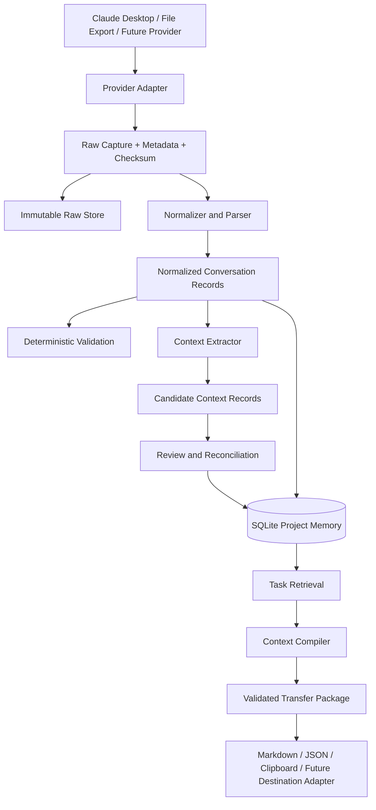

# Continuum: System Architecture, Development Roadmap, and MVP Plan

**Status:** Planning baseline  
**Scope:** Local-first personal-use MVP, evolving from the existing Windows UI Automation proof of concept  
**Planning assumption:** One university student, approximately 8–12 hours per week

## Executive summary

Continuum should be built as a local desktop application that preserves a chain of evidence from an AI conversation to a normalized conversation, from that conversation to proposed context records, and from accepted records to a versioned project memory. A compact transfer package should then be generated from that memory for a specific task and pasted or exported into another AI session.

The recommended first architecture is a modular C++20 application with deterministic ingestion, parsing, persistence, provenance, retrieval, and package validation. AI-assisted extraction may be added behind an explicit interface, but it must produce reviewable proposals rather than silently mutating project memory. SQLite is appropriate for the MVP, with raw source files retained alongside structured records. The existing Claude UI Automation code should become the first provider adapter, not the definition of the entire core system.

The MVP is not “an AI that remembers everything.” It is a reliable local workflow that can import a conversation, preserve its raw form, normalize its messages, associate it with a project, let the user accept or correct a small set of durable context records, and produce a task-specific transfer package with source references and clear uncertainty.

A realistic schedule is approximately **8–11 calendar months and 350–500 focused hours** at 8–12 hours per week, including learning, debugging, test-data creation, documentation, and rework. A genuinely useful early milestone should arrive around **month 4–5**: reliable import plus inspectable project memory and manually generated context packages. A reasonably stable single-provider MVP is more likely around **month 8–11**. Production-grade reliability across application updates and multiple providers is a later effort.

The largest technical risks are extraction instability, false message boundaries, AI-generated false certainty, and insufficient evaluation of whether a fresh AI session can actually resume work. The immediate next action is to freeze the current POC behavior as a baseline, create a sanitized extraction corpus, and write the provider-independent data contracts before adding features.

---

## 1. Project vision and objectives

### The problem

AI conversations currently act as isolated, provider-owned working sessions. A project’s architecture, decisions, implementation state, unresolved bugs, and next steps are distributed across chat histories. When a user changes account, reaches a usage limit, changes provider, or starts a new conversation, the new session lacks the state needed to continue accurately.

Continuum’s core problem is therefore **loss of actionable project context across AI sessions**, not merely the inconvenience of rereading old messages.

### Intended users and initial use cases

The initial user is a technically capable individual who works on a project across multiple AI conversations and needs to move between accounts or providers. Initial use cases are:

1. Import a conversation from a supported desktop client or a local file.
2. Preserve the original evidence and normalize it into stable messages.
3. Associate the conversation with a project.
4. Extract candidate facts, decisions, completed work, open issues, and tasks.
5. Review and correct those candidates.
6. Generate a compact package for a particular next task.
7. Paste or export that package into a new AI session.

The first version does not need automatic synchronization, team collaboration, cloud hosting, or a universal connector framework.

### Summarization versus persistent context management

A summary answers: “What was this conversation about?” Persistent context management answers: “What durable information should affect future work, what is its current status, what evidence supports it, what superseded it, and what should the next agent do?”

A concise summary can still be unusable if it turns a suggestion into a decision, omits an unresolved bug, loses file references, or cannot distinguish old from current information. Continuum should therefore treat summarization as one possible transformation, while its primary product is a **traceable, revisable state model**.

### MVP objectives

The MVP should demonstrate that Continuum can:

- reliably import a bounded set of conversation sources;
- preserve raw evidence and detect incomplete or suspicious imports;
- normalize messages with roles, order, timestamps when available, and stable identifiers;
- maintain a small, inspectable project-memory model;
- preserve provenance and uncertainty;
- retrieve context relevant to a selected task;
- produce a package that a fresh AI session can use to resume a task with less manual explanation.

### Long-term vision

The long-term product is a provider-independent context layer with adapters for different sources and destinations, optional local or external semantic processing, advanced reconciliation, synchronization, and possibly team-level shared context. The long-term vision must not force the MVP to solve provider APIs, distributed consistency, multi-user permissions, or custom-model training prematurely.

### Measurable success outcomes

Success should be measured rather than inferred from package length:

- import completeness and parser precision on a maintained evaluation corpus;
- percentage of imported messages that can be traced to raw evidence;
- duplicate-import rate;
- rate of unsupported claims in accepted context records;
- time required to prepare a transfer package;
- package size under defined task budgets;
- fresh-session task-resumption success compared with a no-context baseline;
- percentage of corrections that can be made without losing history;
- recovery success after interrupted imports or database backups.

---

## 2. Current project status

The following separates confirmed status from recommendations. The project brief is the source of truth for demonstrated outcomes; repository inspection is used to clarify what is currently present in the POC.

### Implemented and demonstrated

- A C++20 CMake executable builds in the stated Windows/MinGW/Ninja environment.
- `ClaudeWindowFinder` enumerates visible windows and selects one whose title contains “Claude.”
- `UiaClient` initializes COM/UI Automation and acquires an element from the selected window.
- `UiTreeDumper` traverses the raw UI Automation tree, writes a diagnostic tree, and searches document elements with `TextPattern` for the largest text candidate.
- A tested Claude Desktop build exposed the active conversation through a RootWebArea/document element, and `DocumentRange.GetText(-1)` retrieved a large conversation without manually scrolling.
- The POC writes raw extracted text and a parsed JSON artifact.
- A basic parser has detected six messages in a tested three-user/three-assistant exchange, according to the project brief.

### Partially implemented

- Conversation acquisition works for the tested active Claude Desktop state, but has no stable provider adapter contract, account identity, conversation ID, extraction checkpoint, or completeness proof.
- Parsing recognizes observed markers such as `You said:`, `Claude responded:`, and `Copy`, but is dependent on UI text and layout assumptions.
- JSON output contains roles and content, but not message IDs, timestamps, source ranges, provider metadata, confidence, or provenance.
- Raw data is preserved as files, but there is no managed raw-source catalog or duplicate-import policy.
- Diagnostic logging is mixed with console output; structured operational logs and failure categories are absent.

### Not yet implemented

- Persistent project storage and migrations.
- Provider/account/conversation identity management.
- A normalized conversation model with source spans and extraction quality status.
- Context records, decisions, tasks, project checkpoints, or reconciliation.
- Human review and correction workflows.
- Task-oriented retrieval and context compilation.
- Transfer-package versioning, validation, and export.
- End-to-end evaluation of fresh-session task resumption.
- Error recovery, incomplete-extraction detection, and regression tests.
- A GUI or a second provider integration.

### Unverified assumptions

- That the same UI Automation tree and markers are stable across Claude Desktop versions, window states, accounts, conversations, and long responses.
- That all visible conversation text is exposed in one best document element.
- That a window title is sufficient to identify the intended account or conversation.
- That UI Automation can consistently retrieve content while the application is loading, virtualizing, or displaying tools/attachments.
- That a parser can infer message boundaries from current markers without additional structural signals.
- That all future providers expose an accessible, permitted, and technically stable extraction route.

### Future research ideas

- Local model-assisted extraction and classification.
- Token-level compression research, including LLMLingua-2 evaluation.
- Fine-tuning for project-context extraction after a labeled corpus exists.
- Automatic synchronization and additional provider adapters.
- Team and multi-user context sharing.

These are research tracks, not MVP dependencies.

---

## 3. Proposed system architecture

### Architectural principles

1. **Evidence before interpretation:** raw extraction is immutable evidence; normalized messages are a derived representation; accepted memory is a reviewed interpretation.
2. **Provider isolation:** the core never receives Claude-specific UI markers or Win32 handles.
3. **Deterministic boundaries:** identity, persistence, deduplication, ordering, validation, versioning, and export schemas should be deterministic.
4. **AI as a proposal mechanism:** models can suggest records or classifications, but cannot silently overwrite accepted memory.
5. **One local application:** use modules and interfaces, not microservices.
6. **Regeneration:** derived records should be reproducible from retained raw data and recorded processing versions whenever practical.

### Logical components

| Component | Responsibility | Initial implementation |
|---|---|---|
| Acquisition coordinator | Starts an import, records status, and invokes an adapter | CLI orchestration |
| Provider adapter | Connects to one source and returns a raw capture plus metadata | Claude UI Automation adapter |
| File importer | Accepts sanitized/plain/JSON exports for testing and fallback | Required early |
| Raw store | Writes immutable capture bytes and checksums | Filesystem under application data |
| Normalizer/parser | Converts capture into ordered messages and diagnostics | Deterministic C++ module |
| Local repository | Stores normalized records, memory, versions, and indexes | SQLite |
| Context extractor | Produces candidate facts, decisions, tasks, and state claims | Rules first; optional model later |
| Review/reconciliation | Validates candidates, detects conflict, and records supersession | Deterministic workflow |
| Memory service | Reads current and historical project context | SQLite-backed module |
| Retrieval service | Selects relevant records for a task | Metadata/full-text first |
| Compiler | Renders a bounded transfer package with instructions and evidence | Deterministic template compiler |
| Exporter | Writes Markdown/JSON package and manifest | Local files/stdout |
| CLI | Exposes import, inspect, review, compile, export, and backup | C++ CLI |
| Observability | Logs events, diagnostics, parser warnings, and timings | Structured local logs |

### Dependency direction

Provider adapters depend on acquisition interfaces and provider-specific code only. Normalization depends on a capture contract, not on Claude. Repository and memory modules depend on domain records and schema migrations. Context extraction consumes normalized conversations and produces proposals. Reconciliation is the only path by which proposals become accepted memory. Compilation consumes accepted memory and selected source records; it should not query provider UI code.

### Architecture diagram



### Source, normalized, memory, and package boundaries

- **Source data:** exact capture bytes, provider metadata, acquisition diagnostics, and checksum. This is evidence and should not be edited in place.
- **Normalized conversation:** ordered messages and attachments represented in a provider-neutral form, with links back to source ranges and parser version.
- **Persistent project memory:** accepted or explicitly user-edited claims about a project, each with status, confidence, provenance, and history.
- **Generated package:** a task-specific rendering made at a point in time. It is disposable and regenerable, but should include the memory/checkpoint version used to create it.

### Deterministic versus model-assisted behavior

Deterministic: acquisition status, hashing, file layout, parsing rules, message ordering, duplicate detection, schema validation, migrations, provenance links, conflict state, versioning, package section structure, token/character budgets, and export serialization.

Potentially model-assisted: identifying candidate decisions, extracting task statements, classifying explicit versus tentative language, semantic similarity retrieval, and drafting a human-readable package. Model output must include model/version, prompt or policy version, confidence, source references, and a review state. The system should remain usable with no model configured.

### Interfaces

The important interfaces are conceptual contracts rather than a large framework:

- `ConversationSourceAdapter`: `discover`, `capture`, `capabilities`, and `diagnostics`.
- `RawCapture`: source type, provider/account hints, capture time, bytes/path, checksum, and completeness signals.
- `ConversationNormalizer`: input capture plus parser version to normalized conversation or diagnostics.
- `ContextProposalEngine`: normalized conversation and project state to proposals.
- `MemoryRepository`: transactional create/read/update/supersede operations.
- `ContextCompiler`: project, task, retrieval policy, and budget to package plus manifest.

The core should use ordinary C++ interfaces and value objects. It does not need plugin DLL loading in the MVP; a compiled-in adapter boundary is sufficient, with future plugins possible if multiple providers justify the complexity.

---

## 4. Recommended technology stack

| Area | Recommendation | Reasoning and boundary |
|---|---|---|
| Core | C++20 | Matches the working POC, Windows APIs, and existing build environment. |
| Build | CMake + Ninja | Already used; add reproducible presets and test targets. |
| Database | SQLite | Embedded, local-first, transactional, mature, searchable, and adequate for personal-scale data. |
| Raw storage | Filesystem objects plus SQLite metadata | Keeps large captures out of rows while allowing checksums and lifecycle tracking. |
| Serialization | JSON for interchange; UTF-8 text/Markdown for human output | Easy inspection and future provider interoperability. Use a tested JSON library rather than handwritten serialization. |
| Testing | GoogleTest or Catch2; choose one | Unit and integration tests for parser, repository, compiler, and fixtures. The choice matters less than fixture discipline. |
| Logging | `spdlog` with structured fields | Better than scattered `iostream`; redact content by default. |
| Retrieval | SQLite FTS5 plus metadata filters | Deterministic and dependency-light. Add embeddings only after keyword retrieval is evaluated. |
| Semantic processing | Rules and phrase/structure heuristics first; optional model adapter | Avoid making cloud inference mandatory and establish a baseline. |
| Compression | Section selection, deduplication, and deterministic truncation first | These solve immediate budget problems without hiding information behind an unvalidated model. |
| Local inference | Deferred; later evaluate `llama.cpp` or another maintained runtime | Only worthwhile after defining model quality, hardware, and privacy requirements. |
| Provider integration | Win32/UI Automation adapter plus file importer | Reflects demonstrated capability and gives a testable non-UI path. |
| CLI | A small argument parser library or a carefully bounded internal parser | Commands should remain scriptable and observable. |
| Future GUI | Defer; consider native Windows UI or Qt only after CLI workflows stabilize | A GUI is not needed to prove the context-transfer thesis. |
| CI | GitHub Actions or another available Windows runner with MSYS2/UCRT64, CMake, Ninja, and tests | Build and test on every change; UI Automation tests remain a separate opt-in/manual lane. |

SQLite alternatives such as a document database, embedded key-value store, or plain files do not provide enough benefit initially. Plain files are useful for raw evidence and exports but become weak for relationships, versioning, conflict state, and search. SQLite should not be treated as an immutable archive; regular backups and schema migrations are required.

Introducing Python is not necessary for the MVP. It could be justified later for model experimentation or evaluation notebooks, but adding a second runtime before the core contracts stabilize would increase packaging and reproducibility work.

---

## 5. Data architecture and schema

The first schema should be relational but modest. Store what is needed for identity, history, provenance, review, and regeneration; store derived summaries only when their generation metadata is recorded.

### Core relationships

```text
Project 1---many Conversation
Provider 1---many Account 1---many Conversation
Conversation 1---many Message
Message 1---many SourceReference
Project 1---many ContextRecord
ContextRecord many---many SourceReference
Project 1---many Task
Project 1---many Checkpoint
Checkpoint 1---many TransferPackage
```

### Illustrative tables

```text
projects(
  id, name, description, created_at, updated_at, current_checkpoint_id
)

providers(
  id, provider_key, display_name, adapter_version
)

accounts(
  id, provider_id, label, external_account_hint, created_at
)

conversations(
  id, project_id, provider_id, account_id, external_id,
  title, captured_at, source_path, source_sha256,
  parser_version, import_status, created_at, updated_at
)

messages(
  id, conversation_id, ordinal, role, content,
  provider_message_id, captured_at, content_sha256,
  source_start, source_end, normalization_status
)

context_records(
  id, project_id, kind, statement, status, confidence,
  lifecycle, created_by, extraction_version,
  created_at, updated_at, supersedes_id
)

tasks(
  id, project_id, title, description, status,
  priority, created_at, completed_at
)

source_references(
  id, context_record_id, conversation_id, message_id,
  source_start, source_end, reference_type
)

checkpoints(
  id, project_id, sequence, label, memory_hash,
  created_at, created_by
)

transfer_packages(
  id, project_id, checkpoint_id, task_id,
  package_version, format, budget, output_path,
  created_at, compiler_version, manifest_hash
)
```

Names are illustrative; the final migration should avoid nullable fields that carry ambiguous meaning.

### Identity and import behavior

- Prefer a provider’s conversation ID when available, but never assume it is globally unique; namespace it by provider/account.
- If no stable external ID exists, derive an import identity from provider, account hint, normalized title, capture characteristics, and source checksum. Treat it as a deduplication hint, not truth.
- Hash raw captures and message content. An identical source checksum should be idempotent unless the user explicitly creates a new revision.
- When the same conversation changes, store a new capture revision and re-normalize; do not overwrite the previous evidence.
- Missing timestamps are represented as unknown, not fabricated. Ordering comes from source order and an ordinal.
- Deleted remote conversations should not delete local evidence automatically. Mark a source as unavailable if the adapter can establish that fact; local history remains.

### Conflicts and supersession

A fact or decision is a claim with lifecycle states such as `proposed`, `accepted`, `rejected`, `superseded`, `uncertain`, and `archived`. A newer claim can supersede an older one while preserving the old record and the reason/source for the transition. Contradictions should be visible as unresolved conflict groups until a user or explicit policy resolves them.

### Stored versus regenerated data

Must store: raw captures, checksums, normalized messages or enough deterministic input to regenerate them, source references, user decisions, accepted context records, conflict/supersession history, schema and processing versions, package manifests, and backups.

Can be regenerated: search indexes, embeddings, draft summaries, candidate proposals, rendered Markdown, and diagnostic tree views—provided the input and generation version remain available.

### Migrations and recovery

Use numbered SQLite migrations and transactional upgrades. Every record that depends on a parser or extraction policy should record that version. Backups should include the database and raw-store directory, with a manifest and restore test. A failed import should be a visible `failed` or `incomplete` operation, not a partially successful conversation presented as complete.

---

## 6. Context representation

Context should be versioned and typed. A record is not just a string; it is a claim about the project, with lifecycle and evidence.

### Suggested categories

- `objective`
- `fact`
- `decision`
- `completed_work`
- `current_state`
- `unresolved_issue`
- `pending_task`
- `future_plan`
- `constraint`
- `preference`

### Illustrative JSON

```json
{
  "context_version": "1.0",
  "project": {
    "id": "project-001",
    "name": "Continuum",
    "objective": "Preserve useful project context across AI sessions locally."
  },
  "records": [
    {
      "id": "decision-014",
      "kind": "decision",
      "statement": "The MVP uses SQLite for local structured persistence.",
      "status": "accepted",
      "confidence": "high",
      "lifecycle": "current",
      "source_references": [
        {"conversation_id": "conv-008", "message_id": "msg-031"}
      ],
      "last_reviewed": "2026-10-10"
    },
    {
      "id": "issue-003",
      "kind": "unresolved_issue",
      "statement": "Parser behavior across Claude UI versions has not been validated.",
      "status": "accepted",
      "confidence": "high",
      "lifecycle": "current",
      "source_references": [
        {"conversation_id": "conv-008", "message_id": "msg-044"}
      ]
    },
    {
      "id": "plan-009",
      "kind": "future_plan",
      "statement": "Evaluate LLMLingua-2 after an MVP transfer benchmark exists.",
      "status": "proposed",
      "confidence": "medium",
      "lifecycle": "current",
      "source_references": [
        {"conversation_id": "conv-008", "message_id": "msg-052"}
      ]
    }
  ],
  "omitted_or_uncertain": [
    "No claim is made that a second provider is currently supported."
  ]
}
```

### Preventing false certainty

Extraction should label speech acts and evidence strength. “We will use SQLite” may be a decision; “we could use SQLite” is a proposal; “SQLite is probably fine” is an uncertain assessment. Rules can detect explicit markers, but ambiguous cases should become proposals requiring review. The accepted-memory path should require either user confirmation or a deterministic policy with strong evidence.

Every generated package should distinguish “current accepted context,” “open issues,” and “proposed/future ideas.” It should never flatten these into one undifferentiated summary.

### Human review

The first review interface can be CLI-based: show proposed records, evidence excerpts, confidence, and actions such as accept, edit, reject, defer, or mark conflict. Edits create a new record version or superseding record; they do not destroy the original proposal or source.

---

## 7. End-to-end workflows

### Workflow A: importing a conversation

1. User chooses `import` and a source: Claude UI Automation or a local file.
2. Adapter records provider/account hints, capture time, application/version hints if available, and diagnostics.
3. Raw bytes are written to a content-addressed or checksum-addressed store.
4. Import metadata is inserted transactionally with `pending` status.
5. The normalizer produces messages, source spans, parser warnings, and a completeness assessment.
6. Validation checks message roles, ordering, empty/duplicated content, suspicious UI controls, and expected markers.
7. The user sees an import report; incomplete or low-confidence captures remain inspectable but are not silently treated as authoritative.
8. The normalized conversation is committed, linked to a project, and indexed.

Initially, project selection and import review may be manual. Automatic account discovery, incremental synchronization, and background polling should wait.

### Workflow B: updating project memory

1. User selects an imported conversation and project.
2. Deterministic rules identify obvious work items, explicit decisions, status statements, and references.
3. Optional semantic processing proposes additional records with evidence links.
4. The system compares proposals with current memory and flags duplicates, contradictions, and likely supersession.
5. User reviews proposals in batches.
6. Accepted records are written in one transaction, creating a new checkpoint or memory revision.
7. Search indexes and derived summaries are refreshed.

The critical rule is that ingestion never directly edits accepted memory without a recorded reconciliation action.

### Workflow C: switching AI accounts

1. User selects a project and describes the next task.
2. Retrieval filters current accepted objective, constraints, decisions, current state, relevant tasks, unresolved issues, and source references.
3. Compiler applies a package template and a budget.
4. Package includes an explicit task, relevant context, known uncertainty, requested next action, and instructions not to assume proposed work is complete.
5. Validator checks package schema, required sections, character/token estimate, stale/conflicting records, and manifest/checkpoint.
6. User exports Markdown/JSON or copies the Markdown to the destination AI session.
7. User can record the continuation conversation as a new import and link outcomes back to the task.

Clipboard integration is convenient but should be optional; writing an export file is easier to test and audit.

### Workflow D: correcting inaccurate memory

1. User opens a context record and sees statement, status, confidence, source excerpts, extraction version, and history.
2. User edits the statement, changes status, rejects it, or marks it as conflicting.
3. The system creates a correction/superseding record and preserves the prior record.
4. Future packages use the current lifecycle state and can include relevant historical context when requested.
5. Deletion removes it from active retrieval, but a user-configurable audit/history policy determines whether the evidence remains in an archive. Sensitive-data deletion should support a deliberate purge operation with a clear warning and backup implications.

Manual review is acceptable for the MVP. Automation should be added only after correction patterns and evaluation data show where it is safe.

---

## 8. Detailed development timeline

At 8–12 hours per week, calendar estimates include normal interruptions, learning, debugging, documentation, and test maintenance. The ranges are intentionally conservative.

### Phase 0 — Architecture baseline and engineering contracts

**Duration:** 2–3 weeks, 20–30 hours.  
**Dependencies:** Current POC.  
**Objective:** Freeze what exists and define provider-neutral contracts.

**Tasks:** document current behavior; archive representative raw/tree outputs; define terminology and data boundaries; decide application-data directory layout; define capture, normalized conversation, context record, package, and diagnostic contracts; define error categories; write an ADR for C++20/CMake/SQLite.

**Deliverables:** architecture document; initial ADRs; sample fixtures; contract diagrams; issue list; non-goals.

**Acceptance criteria:** another developer can explain what is evidence versus derived data; all known POC assumptions are listed; no core interface mentions Claude UI markers.

**Risks:** discovering undocumented behavior or losing the only useful capture.  
**Postpone:** GUI, embeddings, provider plugin loading, model training.

### Phase 1 — Extraction validation and ingestion reliability

**Duration:** 5–8 weeks, 50–80 hours.  
**Dependencies:** Phase 0.  
**Objective:** Determine how reliable the existing UI Automation approach actually is.

**Tasks:** build a sanitized corpus of short, long, multiline, code-heavy, tool-containing, duplicate-looking, and interrupted conversations; capture different window states and Claude versions where available; separate tree diagnostics from extraction; add capture metadata and checksums; measure truncation and repeated text; classify parser failures; improve resource/error handling; define completeness signals; create golden expected outputs.

**Deliverables:** provider-adapter prototype contract; corpus; extraction report; parser fixture suite; import diagnostic format; explicit known limitations.

**Acceptance criteria:** repeated runs on the same fixture are stable; every fixture has expected message count/order/role/content properties; incomplete captures are detectable or clearly marked unknown; no claim of universal Claude compatibility is made.

**Risks:** UI changes, inaccessible states, COM/UIA timing, false confidence from a small corpus.  
**Postpone:** semantic extraction, embeddings, automatic synchronization.

### Phase 2 — Persistent local storage and normalized conversation management

**Duration:** 4–6 weeks, 40–60 hours.  
**Dependencies:** Phase 1 contracts and fixtures.  
**Objective:** Move from output files to durable, queryable, versioned local data.

**Tasks:** add SQLite migrations; implement raw-store metadata; add providers/accounts/conversations/messages; implement import idempotency and revisions; store parser versions and warnings; add FTS5; implement backup/restore smoke tests; expose CLI commands to list, inspect, and reprocess.

**Deliverables:** local database; migration runner; repository tests; import and reprocess commands; backup format.

**Acceptance criteria:** duplicate import does not create unintended duplicates; interrupted import leaves a recoverable status; raw evidence remains available; database can be recreated from fixture inputs.

**Risks:** encoding, transaction boundaries, schema churn, filesystem path handling.  
**Postpone:** vector search and remote databases.

### Phase 3 — Context schema, candidate extraction, and review

**Duration:** 5–7 weeks, 50–70 hours.  
**Dependencies:** normalized messages and persistence.  
**Objective:** Create typed, provenance-bearing context proposals without requiring a model.

**Tasks:** implement record categories and lifecycle; define explicit/proposed/uncertain heuristics; extract tasks, decisions, constraints, and unresolved issues with source spans; record proposals separately from accepted records; build CLI review commands; add conflict and supersession operations.

**Deliverables:** context schema; deterministic proposal engine; review workflow; provenance display; conflict fixtures.

**Acceptance criteria:** a proposal cannot enter accepted memory without a recorded action; source links resolve to messages; proposed work is visibly distinct from completed work; corrections preserve history.

**Risks:** language ambiguity and overconfident heuristics.  
**Postpone:** autonomous memory updates and model-generated authoritative facts.

### Phase 4 — Project memory and checkpoints

**Duration:** 4–6 weeks, 40–60 hours.  
**Dependencies:** Phase 3.  
**Objective:** Represent current project state while retaining history.

**Tasks:** add projects/tasks/checkpoints; implement current versus superseded views; detect duplicate/contradictory claims; add explicit user resolution; hash memory snapshots; implement project inspection reports.

**Deliverables:** project-memory service; checkpoint model; conflict and history reports.

**Acceptance criteria:** a new accepted decision creates a traceable memory revision; old decisions remain discoverable; conflicting current records are surfaced; the current view is deterministic.

**Risks:** too much schema complexity and ambiguous conflict policies.  
**Postpone:** team permissions and shared concurrent editing.

### Phase 5 — Retrieval and context compilation

**Duration:** 4–6 weeks, 40–60 hours.  
**Dependencies:** project memory and FTS5.  
**Objective:** Generate task-relevant context rather than whole-project dumps.

**Tasks:** define task input; implement metadata and FTS retrieval; rank current decisions/constraints/issues; include source references; create Markdown and JSON templates; add deterministic section limits; detect stale/conflicting records; add package manifests and compiler version.

**Deliverables:** `compile` and `export` commands; package schema; package validator; budget reports.

**Acceptance criteria:** the same memory/task produces reproducible output; irrelevant records can be excluded; package includes required objective/state/task/constraints/next-step sections; budget overflow is explicit.

**Risks:** retrieval misses important context or includes too much; token estimation differences across destination models.  
**Postpone:** model-specific compression and destination API posting.

### Phase 6 — Transfer workflow and fresh-session evaluation

**Duration:** 4–6 weeks, 40–60 hours.  
**Dependencies:** compiler and stable fixtures.  
**Objective:** Prove the central value end to end.

**Tasks:** define resume-task benchmark; create sanitized tasks with known continuation outcomes; export packages; test with fresh AI sessions manually; compare package/no-package performance; record errors and needed context; import continuation conversations; refine templates and retrieval policy.

**Deliverables:** transfer benchmark; evaluation report; package template revision; end-to-end scripts/documentation.

**Acceptance criteria:** a fresh session can perform a defined continuation task using the package with measurable improvement over baseline; failures are categorized; no unsupported claim is counted as a success.

**Risks:** evaluation subjectivity and destination-model variability.  
**Postpone:** claiming provider-independent success from one destination model.

### Phase 7 — MVP stabilization

**Duration:** 6–9 weeks, 60–90 hours.  
**Dependencies:** Phases 1–6.  
**Objective:** Make the single-provider CLI workflow safe and repeatable.

**Tasks:** regression suite; import cancellation/retry; database migration tests; backup/restore; redacted logs; documentation; packaging; performance checks on long captures; security review; failure messaging; manual release checklist.

**Deliverables:** versioned CLI MVP; user guide; test corpus and metrics; release artifact; known-limitations document.

**Acceptance criteria:** core tests pass in CI; fixture imports are repeatable; backups restore; packages are versioned and validated; critical failures do not silently produce authoritative memory.

**Risks:** scope creep, Claude UI changes, insufficient time for evaluation.  
**Postpone:** GUI, automatic sync, multiple simultaneous providers, custom compression models.

### Timeline and sequencing

Phases 0–2 should remain substantially sequential because contracts and ingestion evidence constrain all later work. Documentation, corpus preparation, SQLite migration design, and CLI UX sketches can overlap with Phase 1. Phases 3 and 4 can overlap late in implementation, but reconciliation should not be finalized before the context schema is stable. Retrieval and compiler work can overlap after the first memory queries exist. Evaluation should begin before stabilization, not after it.

The earliest genuinely useful milestone is late Phase 4 or early Phase 5, around month 4–5: the user can import, review, correct, and inspect project memory, then manually use a generated package. The MVP becomes credible only after Phase 6 demonstrates fresh-session continuation and Phase 7 hardens failure behavior.

### Post-MVP tracks

- **Additional providers:** one adapter at a time; validate permissions and interface stability before implementation.
- **Automatic synchronization:** incremental capture, change detection, and deletion semantics only after import identity is reliable.
- **Advanced reconciliation:** model-assisted contradiction grouping and temporal reasoning, always reviewable.
- **Compression research:** benchmark selection, deduplication, extractive shortening, and model compression separately.
- **LLMLingua-2:** evaluate only against a fixed transfer benchmark; measure task success, not just token reduction.
- **Local inference:** characterize hardware, models, latency, and privacy before selecting `llama.cpp` or another runtime.
- **Fine-tuning:** only after enough labeled proposal/review data and a clear quality improvement hypothesis.
- **GUI:** build around proven CLI commands and workflows, especially review/conflict inspection.
- **Team features:** introduce identity, access control, merge semantics, and encrypted sharing as a separate product track.

---

## 9. MVP scope and exclusions

### Capabilities required

1. Windows local CLI.
2. Claude UI Automation import for the validated target environment.
3. Local-file import for fixtures and recovery.
4. Immutable raw capture storage with checksums.
5. Normalized user/assistant messages with warnings and source references.
6. SQLite persistence with migrations and duplicate detection.
7. Project association and a small typed context schema.
8. Candidate extraction that works without a cloud model.
9. Human review, correction, rejection, and supersession.
10. Current-memory and history views.
11. Task-oriented retrieval.
12. Markdown/JSON transfer-package export with a budget and manifest.
13. Backup/restore and regression tests.
14. A fresh-session resumption benchmark.

### Explicit exclusions

- mandatory cloud AI calls;
- custom model training or fine-tuning;
- LLMLingua-2 as a prerequisite;
- multiple provider integrations in the first release;
- background synchronization;
- elaborate GUI;
- multi-user collaboration and access control;
- autonomous deletion or silent conflict resolution;
- microservices or hosted infrastructure;
- claims of compatibility with every Claude version or AI provider.

These exclusions protect the central experiment: whether reliable, provenance-preserving context transfer is useful.

---

## 10. Testing and evaluation

### Test layers

- **Extraction fidelity:** compare raw capture properties and hashes; detect truncation, missing paragraphs, duplicated sections, control labels, and encoding damage.
- **Parser correctness:** golden fixtures for roles, multiline text, code blocks, quotes, repeated openings, tools, empty messages, and unusual ordering.
- **Duplicate detection:** repeated imports, revised captures, same content with different metadata, and similar but non-identical conversations.
- **Storage integrity:** migration upgrades, transaction rollback, interrupted imports, foreign-key relationships, backup/restore, and reprocessing.
- **Context correctness:** explicit decision versus proposal, completed versus planned work, uncertainty, source resolution, and supersession.
- **Conflict handling:** contradictory decisions, old/current state, user correction, and unresolved-conflict package behavior.
- **Token efficiency:** package size by section and budget; compare selection/truncation policies without equating shorter with better.
- **Transfer quality:** task completion, number of clarification turns, incorrect assumptions, and time to productive continuation.
- **Regression:** every discovered failure becomes a fixture or documented manual test.

### Evaluation corpus

Start with synthetic conversations designed to test one phenomenon at a time, then add sanitized real captures. Include architecture discussions, implementation updates, debugging sessions, abandoned proposals, explicit reversals, code blocks, long answers, and conversations with irrelevant UI text. Store expected annotations separately from production raw data and remove secrets.

### Fresh-session resumption protocol

For each benchmark task, define:

1. the project state and target continuation task;
2. the relevant source conversations;
3. an expected set of facts, constraints, and next actions;
4. a baseline prompt with minimal manual explanation;
5. a Continuum-generated package;
6. a fresh destination session with no prior project history;
7. an objective scoring rubric.

Score whether the fresh session identifies the correct current state, respects constraints, avoids claiming proposed work is complete, asks for missing information appropriately, and produces the expected next action or code change. Compare against the baseline and record model/provider/session variability. A package is successful only if it improves task resumption without introducing materially more false assumptions.

Do not invent acceptance percentages before measuring a baseline. First collect results, then set thresholds that reflect observed variance and the project’s risk tolerance.

---

## 11. Security and privacy

Conversation data may contain credentials, personal information, proprietary code, or private plans. The MVP should treat all captures as sensitive.

- Store the database and raw files in a user-scoped application-data directory, not in the source repository.
- Add repository exclusions for raw captures, databases, exports, logs, and generated packages.
- Use restrictive filesystem permissions where practical and document the storage location.
- Never log full message content by default. Log IDs, lengths, hashes, parser events, and redacted excerpts only when explicitly enabled.
- Add secret-pattern warnings for API keys, tokens, private keys, passwords, and connection strings. Warnings are not a substitute for deletion or rotation.
- External model calls must be opt-in per operation, show what data will leave the machine, and record that consent in the operation history.
- Exports should be explicit, named, and easy to locate; warn that Markdown/JSON packages may contain sensitive content.
- Provide project deletion and raw-capture purge operations with confirmation and clear backup consequences.
- Backups should be encrypted by the user’s chosen mechanism where feasible; at minimum document that copying the database copies sensitive history.
- Test restore and deletion behavior. “Deleted from active retrieval” must not be confused with secure erasure from every backup.

The POC’s generated `output` directory should be treated as development data and kept out of source control in the future.

---

## 12. Key architectural decisions

| Decision | Recommendation | Alternatives | Rationale | Consequences | Timing |
|---|---|---|---|---|---|
| Core language | Continue C++20 | Add Python/Rust | Existing Win32/UIA work is valuable | More manual application plumbing | Now |
| Persistence | SQLite + raw filesystem | Plain files, document DB | Transactions, relationships, FTS5, local-first | Must manage migrations/backups | Now |
| Provider boundary | Adapter interface | Claude-specific core | Protects future independence | Requires normalized contracts | Now |
| Parser strategy | Deterministic, fixture-driven first | Model-only parsing | Reproducible and debuggable | More rules initially | Now |
| Memory updates | Proposal → review → accepted | Automatic mutation | Prevents false certainty | Some manual work | Now |
| Retrieval | FTS5 + metadata first | Embeddings immediately | Establishes measurable baseline | Semantic recall may be lower initially | Now |
| Package format | Versioned Markdown + JSON manifest | Provider API posting | Human-readable and portable | User performs final paste initially | Now |
| Compression | Selection/deduplication/truncation | LLMLingua/custom model | Lower risk and transparent | Less aggressive compression | Now |
| GUI | Defer | Qt/native UI now | CLI exposes testable primitives | Less polished UX initially | Defer |
| Local model | Optional later | Mandatory cloud model | Preserves privacy and operability | Rules may be less semantic | Defer |
| Plugin loading | Compiled adapters initially | Dynamic plugins | Avoids premature ABI complexity | Adding providers requires a build change | Defer |

### Unresolved questions requiring information

- Which exact Claude Desktop versions and window states must be supported?
- Is the intended use limited to the active visible conversation, or must historical/sidebar conversations be selected programmatically?
- Which destination AI sessions are in the MVP evaluation, and how will task success be scored?
- What hardware is available for optional local inference? The spare laptop must be measured before making model claims.
- What retention and deletion policy does the user want for raw captures and backups?
- Are attachments, images, tool calls, and web citations in scope for the first normalized schema, or only text messages?
- Is a clipboard export acceptable, or is a provider-specific destination adapter required for the first transfer demonstration?

These questions affect scope and evaluation, but do not block the first validation phase.

---

## 13. Immediate next steps

1. Commit this planning baseline and an explicit MVP/non-goals document to project documentation.
2. Record the current POC build command, environment, observed Claude version, window state, and known output artifacts.
3. Create a sanitized fixture corpus covering short, long, multiline, code, duplicated, tool-containing, and incomplete conversations.
4. Define the `RawCapture`, normalized message, diagnostic, context proposal, accepted record, and transfer-package contracts in a short architecture ADR set.
5. Measure current extraction and parser behavior against the fixtures; record failures rather than fixing by assumption.
6. Decide the application-data and raw-store layout, including repository exclusions and backup expectations.
7. Select and add the test framework and structured logger only after confirming they build in the current MSYS2/CMake environment.
8. Design the smallest SQLite migration for providers, accounts, conversations, messages, source references, and import operations.
9. Define the first fresh-session transfer benchmark before implementing retrieval or compression.
10. Implement the next work item only after the Phase 1 acceptance criteria and failure taxonomy are written.

The first implementation priority is therefore **validation and contracts**, not a large new context engine. If the extraction evidence is unreliable, every later memory feature will merely make unreliable input look more authoritative.

